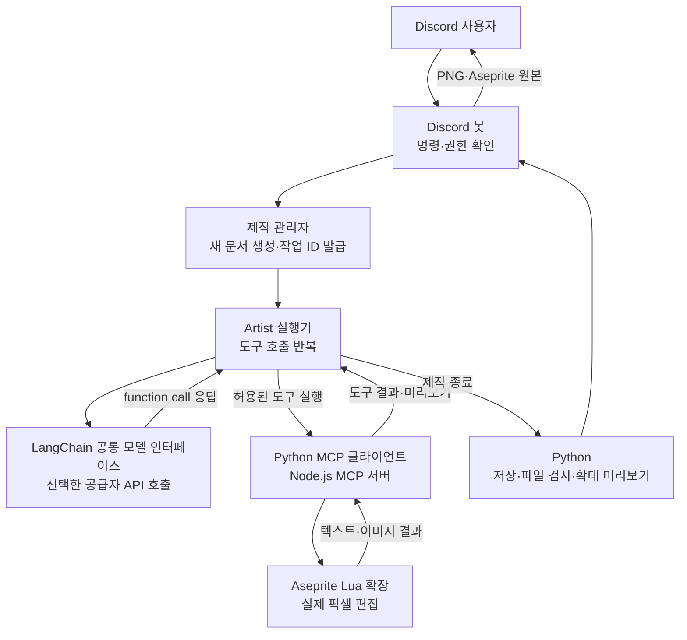

# PixelStudio

Discord에서 자연어로 요청하면 LangChain으로 모델 API를 호출하는 Artist가 로컬 Aseprite에서
32×32 픽셀아트를 만들고, 미리보기와 원본 파일을 Discord로 반환하는 프로젝트입니다.

## 1. 파일 구조

```text
PixelStudio/
├─ README.md                         # 프로젝트 사용법과 Q&A
├─ pyproject.toml                    # 의존성·Python 패키지·실행 명령 설정
├─ uv.lock                           # 설치 버전 고정
├─ .python-version                   # 프로젝트 Python 버전
├─ .env.example                      # 공유용 설정 양식
├─ .env                              # 개인 설정·API 키·Discord 토큰
├─ .gitignore                        # Git에서 제외할 경로
├─ src/
│  └─ pixelstudio/
│     ├─ __init__.py                 # pixelstudio 패키지
│     ├─ cli.py                      # pixelstudio 명령의 진입점
│     ├─ bot.py                      # Discord 명령·접근 권한·결과 전송
│     ├─ config.py                   # 프로젝트 .env 읽기·설정 검증
│     ├─ model_client.py             # LangChain 모델 연결·인증·오류 처리
│     ├─ agent.py                    # 모델 호출·도구 실행·이미지 피드백 반복
│     ├─ artist.py                   # 문서 생성부터 결과 저장까지 제작 과정 관리
│     ├─ mcp_client.py               # 로컬 Aseprite MCP 연결·호출
│     ├─ mcp_smoke.py                # 모델 없이 도형 제작·저장 확인
│     ├─ artifacts.py                # 파일 검사·저장·확대 미리보기
│     └─ prompts/
│        └─ artist.md                # Artist의 한국어 제작 지침
└─ outputs/                          # 실행 시 자동 생성, Git 제외
   └─ <작업 ID>/
      ├─ sprite.aseprite             # 32×32, 1프레임 원본
      ├─ sprite.png                  # 원본 크기의 PNG
      ├─ preview.png                 # 256×256 확대 미리보기
      └─ report.json                 # 상태·모델·도구 기록·성공 시 토큰 사용량
```

코드는 `bot.py` → `artist.py` → `agent.py` → `mcp_client.py` 순서로 읽으면
Discord 요청이 그림 제작으로 이어지는 흐름을 따라갈 수 있습니다.

## 2. agent 호출 구조

현재는 **Artist 에이전트 하나**가 제작합니다. 역할은 `prompts/artist.md`에서 정의하고,
모델은 `.env`의 `MODEL_PROVIDER`·`MODEL_NAME`과 해당 공급자의 API 키로 선택합니다.
기존 `OPENAI_API_KEY`·`OPENAI_MODEL` 설정도 그대로 사용할 수 있습니다.



제작 순서는 다음과 같습니다.

1. 봇이 `/draw`의 사용자·서버·채널 권한을 확인합니다.
2. Python이 API 설정을 확인하고 작업 폴더와 새 32×32 문서를 만듭니다.
3. Artist가 사용자 설명·제작 지침·MCP 리소스를 참고해 API에 요청합니다.
4. 모델이 도구 이름과 인자를 반환하면 Python이 인자와 허용 범위를 검사합니다.
5. Python이 MCP 도구를 실행합니다. 모델은 현재 작업의 문서만 편집할 수 있습니다.
6. 픽셀 변경 뒤 실제 미리보기를 이미지 입력으로 모델에 전달합니다.
7. 모델이 작업을 마치면 Python이 원본과 PNG를 저장하고 실제 파일을 검사합니다.
8. 최근접 보간으로 만든 8배 미리보기와 원본 파일을 Discord에 첨부합니다.

저장 경로·문서 생성·내보내기는 Python이 담당합니다. 모델에는 셸 실행이나 임의 파일
저장 도구를 주지 않습니다. Aseprite MCP 서버는 Node.js로, 확장은 Aseprite 내부의
Lua로 실행됩니다. Python이 필요할 때 MCP 서버를 시작하므로 `serve`를 따로 켤 필요는 없습니다.

OpenAI 요청에는 `store=False`를 사용합니다. 프로그램이 대화 문맥을 직접 전달하고,
Codex 앱의 대화 목록에는 제작 요청을 생성하지 않습니다. 이 설정이 OpenAI의 API
데이터 보관 정책 전체를 끈다는 뜻은 아닙니다. 다른 공급자는 해당 서비스의 정책을 따릅니다.

현재는 한 번에 한 제작 작업만 실행합니다. 다른 요청은 대기열에 저장되지 않고
진행 중 안내를 받습니다. Planner·Reviewer·Fixer 역할 분리와 LangGraph 검토·수정 루프,
여러 서버·채널 목록, 작업 대기열은 향후 구현할 기능입니다.

관련 공식 문서: [LangChain 모델](https://docs.langchain.com/oss/python/langchain/models),
[Function calling](https://developers.openai.com/api/docs/guides/function-calling),
[MCP 클라이언트](https://modelcontextprotocol.io/docs/develop/build-client).

## 3. 요금 정책

**봇의 API 비용은 요청자와 관계없이 .env에서 선택한 공급자의 API 키 결제 계정이 부담합니다.**

/ping과 /aseprite는 모델 API를 호출하지 않아 API 비용이 발생하지 않습니다.

정확한 사용 내역은 [OpenAI API 사용량 화면](https://platform.openai.com/usage)에서 확인합니다.
다른 공급자를 사용하면 해당 공급자의 사용량 화면에서 확인합니다.

## 4. 명령어

필요 환경은 Python 3.12, uv, Node.js 22.6 이상, Aseprite 1.3 이상입니다.
현재 MCP 패키지는 확장과 같은 `0.8.2` 버전으로 고정합니다.

### 터미널 명령

프로젝트 폴더에서 실행합니다.

```powershell
cd {PixelStudio}
uv sync --locked
```

| 명령 | 동작 | 모델 API 호출 |
| --- | --- | --- |
| `uv run pixelstudio --help` | 실행 가능한 명령 확인 | 없음 |
| `uv run pixelstudio bot` | Discord 봇 실행 | 시작 자체는 없음, `/draw` 수신 시 발생 |
| `uv run pixelstudio check-api` | 설정한 API 키·모델로 텍스트 연결 확인 | 있음 |
| `uv run pixelstudio check-mcp` | 연결 상태와 현재 열린 문서 확인 | 없음 |
| `uv run pixelstudio test-mcp` | 새 테스트 문서에 도형을 그리고 저장 | 없음 |
| `uv run pixelstudio draw --prompt "초록색 슬라임, 큰 눈"` | Discord 없이 API 제작 전체 경로 실행 | 있음 |
| `uv run pytest -q` | 자동 테스트 실행 | 없음 |
| `uv build` | 배포용 패키지 빌드 | 없음 |

`test-mcp`는 실제 Aseprite에 새 문서를 만듭니다. `check-mcp`는 문서를 수정하지 않습니다.
봇 프로세스를 종료하려면 해당 터미널에서 `Ctrl+C`를 누릅니다.

Aseprite 확장을 처음 설치하거나 같은 버전으로 맞출 때만 다음 명령을 사용합니다.

```powershell
npx @pebbly/aseprite-ai-artist@0.8.2 install-extension
```

설치 후 Aseprite를 완전히 종료했다가 다시 실행합니다.
프로젝트가 참고하는 확장·서버는 [Aseprite AI Artist](https://github.com/with-pebbly/aseprite-ai-artist)입니다.

### Discord 명령

| 명령 | 동작 | 사용 조건 |
| --- | --- | --- |
| `/ping` | 봇이 응답하는지 확인 | 서버의 명령 사용 권한 |
| `/aseprite` | MCP를 직접 조회해 Aseprite 연결 상태 표시 | `DISCORD_OWNER_ID`의 사용자 |
| `/draw prompt:초록색 슬라임, 큰 눈, 귀여운 표정` | 32×32 정지 그림 제작·파일 반환 | 아래 `.env`의 `/draw` 접근 정책 |

## 5. .env 설정 방법

프로젝트 루트에 `.env`를 만듭니다. `.env.example`을 복사하고 내용을 채워넣습니다.

봇에서 그림 제작까지 사용하려면 다음 다섯 항목을 입력합니다.

```dotenv
OPENAI_API_KEY=
OPENAI_MODEL=
DISCORD_BOT_TOKEN=
DISCORD_GUILD_ID=
DISCORD_OWNER_ID=
```

| 항목 | 넣을 값 |
| --- | --- |
| `OPENAI_API_KEY` | 본인의 OpenAI API 프로젝트에서 발급한 실제 API 키 |
| `OPENAI_MODEL` | 이미지 입력과 function calling을 지원하고 API 계정에서 사용할 수 있는 모델 ID |
| `DISCORD_BOT_TOKEN` | Discord Developer Portal의 Bot 메뉴에서 발급한 토큰 |
| `DISCORD_GUILD_ID` | 명령을 등록할 Discord 서버의 ID |
| `DISCORD_OWNER_ID` | 봇 소유자의 Discord 사용자 ID |

OpenAI 실연동 검증에 사용한 모델은 `gpt-5.6-luna`입니다. 기본 모델은 지정하지 않으므로
`MODEL_NAME` 또는 기존 `OPENAI_MODEL`에 직접 입력합니다. 다른 공급자는 초기화·도구 연결만 검증했습니다.

공급자를 바꾸려면 `MODEL_PROVIDER=openai|anthropic|google_genai` 중 하나와
`MODEL_NAME`을 설정하고, 각각 `OPENAI_API_KEY`·`ANTHROPIC_API_KEY`·`GOOGLE_API_KEY`를 입력합니다.
`MODEL_NAME`이 있으면 `OPENAI_MODEL`보다 우선합니다. Anthropic은
`uv sync --locked --extra anthropic`, Google은 `uv sync --locked --extra google`로 연결 패키지를 설치합니다.
선택한 모델은 이미지 입력과 도구 호출을 모두 지원해야 합니다. Discord 명령은 동일합니다.

### 서버·채널·사용자 ID 찾기

일반 Discord 앱의 **사용자 설정 → 고급 → 개발자 모드**를 켭니다.

- 서버 ID: 왼쪽 서버 아이콘 우클릭 → 서버 ID 복사
- 채널 ID: 텍스트 채널 이름 우클릭 → 채널 ID 복사
- 사용자 ID: 사용자 프로필 우클릭 → 사용자 ID 복사

세 ID는 서로 다른 값입니다. Developer Portal의 Application ID도 이들과 다릅니다.

### /draw 접근 정책

```dotenv
DISCORD_ALLOWED_CHANNEL_ID=
```

| 값 | 현재 코드의 동작 |
| --- | --- |
| 비워둠 또는 생략 | 설정한 서버에서 소유자만 `/draw` 사용 가능 |
| 채널 ID 하나 입력 | 설정한 서버의 해당 채널에서 다른 사용자도 `/draw` 사용 가능 |

채널을 지정했다면 소유자도 다른 채널에서 `/draw`를 실행할 수 없습니다.
해당 사용자는 Discord의 채널 접근·애플리케이션 명령 사용 권한도 가지고 있어야 합니다.
`/aseprite`는 이 설정과 관계없이 소유자 전용입니다.

현재 서버 ID와 채널 ID는 각각 하나만 지원합니다. 다른 서버로 바꾸려면
`DISCORD_GUILD_ID`를 교체하고 봇을 그 서버에 초대합니다. 채널 제한을 사용 중이라면
새 서버의 채널 ID로도 교체합니다. 쉼표로 여러 ID를 넣는 방식은 아직 지원하지 않습니다.

### 선택 설정과 기본값

다음 항목은 생략하면 코드의 기본값을 사용합니다.

```dotenv
ASEPRITE_MCP_PACKAGE=@pebbly/aseprite-ai-artist@0.8.2
MCP_TIMEOUT_SECONDS=30
JOB_TIMEOUT_SECONDS=480
MAX_AGENT_ROUNDS=16
MAX_TOOL_CALLS=32
MAX_OUTPUT_TOKENS=6000
```

| 설정 | 의미 |
| --- | --- |
| `ASEPRITE_MCP_PACKAGE` | 실행할 npm MCP 패키지와 버전 |
| `MCP_TIMEOUT_SECONDS` | 개별 MCP 요청 제한 시간(초) |
| `JOB_TIMEOUT_SECONDS` | 제작 작업 전체 제한 시간(초) |
| `MAX_AGENT_ROUNDS` | 작업 하나에서 허용할 모델 호출 횟수 |
| `MAX_TOOL_CALLS` | 모델 실행 중 허용할 MCP 호출 횟수. 자동 이미지 피드백 호출도 포함 |
| `MAX_OUTPUT_TOKENS` | API 응답 하나의 출력 토큰 상한. 작업 전체 입력 토큰·비용 한도는 아님 |

프로세스 환경 변수에 같은 이름이 있으면 `.env`보다 환경 변수를 우선합니다.
설정을 바꿨다면 봇을 종료하고 `uv run pixelstudio bot`으로 다시 실행합니다.
실제 키가 들어 있는 `.env`는 Git에 올리지 않고 `.env.example`에는 설정 이름과 설명만 남깁니다.
